# 交付入口

- 在线运行：https://jinye2383-gif.github.io/Computer-Graphics/AP2/
- 源码：[源码.zip](源码.zip)
- 漫游录屏：[10 秒 WebM](evidence/05-tour-10s.webm)

# AP2 · 轨道之间：三维层级太阳系

WebGL + 教材 MV.js 实现。完成 Baseline 六项，以及 E1：八颗行星、土星环和小行星带。E2（日月食阴影模拟）与 E3（虚拟轨迹球）不在本次实现范围；鼠标使用方位角/俯仰角轨道控制。

## 运行

双击 `start.bat`，打开 **http://127.0.0.1:5174**。本机已具备 Node.js，无需 npm 安装。也可在项目目录运行：

```powershell
node server.cjs
```

保留服务窗口，按 `Ctrl+C` 停止。若首次浏览器打开早于服务器启动，刷新即可。端口被占用时先关闭本项目原来的服务窗口，或执行 `$env:PORT=5175; node server.cjs` 后访问新端口。不要直接双击 HTML，以免浏览器文件协议限制纹理加载。

**公网地址：** https://jinye2383-gif.github.io/Computer-Graphics/AP2/

## 操作与演示顺序

1. 全景观察太阳、八颗行星、土星环、小行星带。
2. 选择“地月系统”，观察地球蓝色自转轴和月球倾斜轨道。
3. 修改公转、自转速度与地球轴倾角；速度 0 表示对应运动停止。
4. `O` 切换正交/透视；`空格` 暂停/继续天体运动与相机漫游。输入框/按钮获得焦点时保留其原生键盘操作，点击画布后可继续使用全局快捷键。
5. 鼠标拖拽随时接管相机，滚轮缩放。点击“继续漫游”从当前方位恢复，避免跳回起点；“漫游中”按钮可单独关闭自动相机。
6. 勾选或关闭轨道线、地球自转轴和名称；“重置”恢复默认参数。

拖拽在全局暂停时仍可用，用于冻结时刻后观察。相机路径以 80 秒环绕一周、俯仰角平滑变化构成；手动接管后恢复时，俯仰角渐近回到路径，不发生瞬间跳变。

## 层级结构与变换顺序

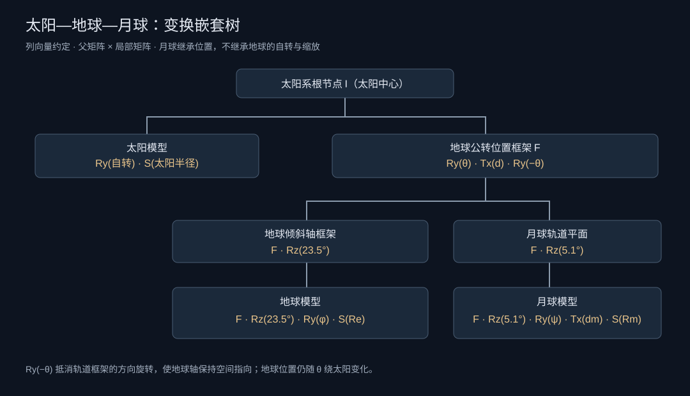

```text
太阳系根节点（原点 / 太阳中心）
├─ 太阳模型：自转 → 尺寸
├─ 各行星公转位置框架
│  └─ 行星倾斜轴 → 自转 → 尺寸
└─ 地球公转位置框架 F
   ├─ 地球倾斜轴 Rz(23.5°)
   │  └─ 地球自转 Ry(φ) → 尺寸 S(Re)
   └─ 月球轨道面 Rz(5.1°)
      └─ 月球公转 Ry(ψ) → 轨道平移 Tx(dm) → 尺寸 S(Rm)
```

树表示父子依赖，不表示点的运算执行顺序。采用齐次列向量 `p' = M p`，右边的矩阵先作用于点。`scene.js` 用 `mat4`、`rotate`、`translate`、`scalem` 和 `mult` 逐层相乘；没有使用 Three.js 或封装的天体运动组件。

地球公转框架与局部模型：

```text
F       = I · Ry(θ) · Tx(d) · Ry(−θ)
L_earth = Rz(23.5°) · Ry(φ) · S(Re)
M_earth = F · L_earth
```

局部球体先缩放、绕自身 Y 轴旋转，再通过 `Rz(23.5°)` 使整个自转轴倾斜；这个倾斜后的局部模型再挂到公转框架上。`Ry(−θ)` 抵消公转框架的方向变化，但不抵消已经产生的位置变化，使地球轴在空间中保持固定指向。若把轴倾斜放到轨道平移左侧作为全局旋转，地球中心的公转轨道也会被倾斜，这是另一种结构。

月球继承 **F**，不继承 `M_earth`：否则地球自转会带动月球公转，地球半径缩放也会错误缩小月球轨道。月球模型朝向继承自身公转，形成简化同步自转。

## 手动矩阵构造：月球轨道倾角

`dist/js/scene.js` 中实际调用：

```js
const inclinedPlane = mult(mat4(), rotate(SYSTEM.moonInclination, [0, 0, 1]));
result.moonPlane = mult(frame, inclinedPlane);
result.moonFrame = chain(result.moonPlane,
  rotate(360 * orbitTime / SYSTEM.moonPeriod, [0, 1, 0]),
  translate(SYSTEM.moonDistance, 0, 0));
result.moonModel = mult(result.moonFrame,
  scalem(SYSTEM.moonRadius, SYSTEM.moonRadius, SYSTEM.moonRadius));
```

`chain` 只通过 `reduce` 逐次调用 MV.js 的 `mult`，不是工具库的复合变换函数。月球完整模型为 `F · Rz(i) · Ry(ψ) · Tx(dm) · S(Rm)`，其中 `i = 5.1°`。以月球球心 `p = (0,0,0,1)` 为例：先平移至轨道半径 `dm`，绕 Y 轴公转，然后用 `Rz(i)` 倾斜整条轨道，最后加上地球中心的位置。

```text
Rz(i) = [ cos(i)  −sin(i)  0  0 ]
        [ sin(i)   cos(i)  0  0 ]
        [   0        0    1  0 ]
        [   0        0    0  1 ]

Tx(d) = [ 1  0  0  d ]
        [ 0  1  0  0 ]
        [ 0  0  1  0 ]
        [ 0  0  0  1 ]
```

这种乘法保留月地距离 `dm`，而月球的高度随公转角度变化。MV.js 的矩阵采用行数组保存，`flatten` 在上传给 WebGL 时转成所需列主序；调用 `uniformMatrix4fv` 的 transpose 参数始终为 `false`。

## 纹理、光照与 UV

太阳、地球、月球均使用实际 JPG 位图，经 `Image.decode()` 加载，再由 `gl.texImage2D` 上传。球体顶点包含位置、法线和 `aUV` 纹理坐标 attribute，片元着色器调用 `texture2D` 采样。所有资源随项目保存，运行时不依赖外网。

球体北极取 `v=1`，南极取 `v=0`。图片最上方是北极，因此上传前设置 `gl.pixelStorei(gl.UNPACK_FLIP_Y_WEBGL, true)`，将图片的上边映射到纹理高 v 端。如果 UV 另行倒置，就不能再重复翻转。球面接缝复制 u=0/1 两列顶点，纹理采用 `CLAMP_TO_EDGE`；2 的幂次尺寸生成 mipmap，使用三线性过滤，并在支持时开启最高 16 倍各向异性过滤，减少远景闪烁与斜视模糊。

太阳日面采用独立的自发光材质，外侧以朝向相机的透明面片绘制径向衰减的柔和光晕；其余球体在近似线性颜色空间中计算 Lambert 漫反射及 4.5% 环境光，再进行 gamma 显示编码。地球额外加入海洋高光、夜景灯光、独立旋转的透明云层和蓝色大气边缘。土星环使用带透明度的位图，并计算土星本体在环上的解析遮影；没有实现地月之间的食现象阴影，所以不宣称完成 E2。木星、土星、天王星和海王星加入近似扁率，通过局部 Y 方向非均匀缩放实现。所有模型的法线都使用 MV.js 的 `normalMatrix(model, true)`（逆转置矩阵）变换，避免非均匀缩放下出现错误光照。扁率集中在 `config.js` 的 `POLAR_RATIO` 中。

当前太阳、月球和八颗行星使用 Solar System Scope 的高分辨率纹理，署名与 CC BY 4.0 授权说明见 `THIRD_PARTY.md`。原始 2K～8K 资源保留在本地，全景球面 GPU 纹理最高为 4K；切换近景时按需上传原生分辨率，最高 8K，切换目标后释放上一张近景 GPU 纹理，避免同时堆积多张 8K 贴图。土星环由原始 8192×500 在运行时采样为 8192×512，保留径向像素并开启 mipmap；金星采用云层外观。轨道距离、球体半径和周期集中在 `dist/js/config.js`，为可视性做了压缩，不代表真实比例或精确天体力学。

## 同场景双投影对比

下列两张截图使用相同天体时间、相机位置、目标、窗口大小，仅切换投影矩阵。截图时暂停模拟并关闭漫游，确保比较有效。透视视场角 42°；正交半高采用 `distance * tan(42° / 2)`，使目标平面附近的尺寸大致匹配。

| 透视投影 | 正交投影 |
|---|---|
| 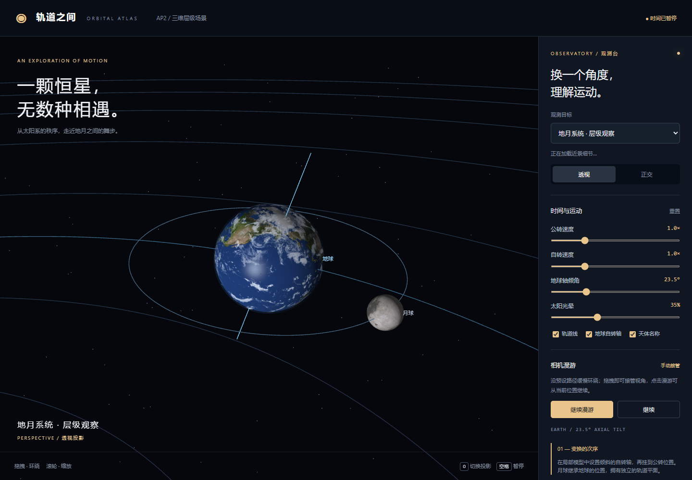 | 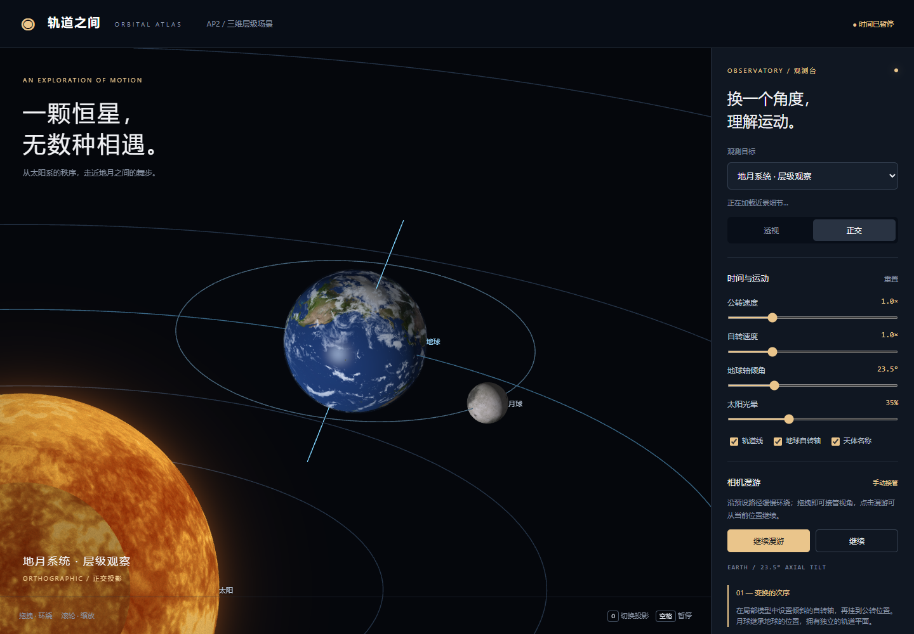 |

透视经过齐次除法，远处物体在屏幕上缩小，近处放大；不平行于成像面的空间平行线可向消失点汇聚。正交投影不随深度改变比例，平行线仍平行（沿视线方向投影退化为点的情况除外）。两图中背景天体的相对大小和轨道分布明显不同；轨道是圆的投影，不应把轨道曲线本身称为平行直线。

## 演示与运行证据

- [全景截图](evidence/01-solar-system.png)
- [土星环近景](evidence/04-saturn.png)
- [真实 WebGL 画布漫游录屏，约 10 秒](evidence/05-tour-10s.webm)
- [浏览器与矩阵验证明细](evidence/verification.json)
- [本机测试输出](evidence/test-run.log)

录屏由本机 Edge 页面内 `canvas.captureStream(30)` + `MediaRecorder` 实时捕获，不是图片拼接或渲染示意视频。视频包含画布天体运动与相机漫游，参数面板属于 DOM，不在画布录屏内。

验证脚本涵盖公转半径、月地距离、月球独立性、地轴倾角与固定方向、月球轨道倾角、矩阵顺序、13 张贴图加载、投影按键、暂停/继续、速度和倾角控件、轨道开关、拖拽接管和漫游恢复、移动宽度与浏览器/WebGL 错误。复现测试需要 Node.js、Playwright 与本机 Edge；普通运行不需要 Playwright。先启动服务，再运行 `node tests/verify.cjs`（若 Playwright 不在项目模块路径中，需要配置 `NODE_PATH` 指向其安装目录）。

## 文件结构

```text
AP2-solar-system/
├─ start.bat / server.cjs   本机启动入口与零 npm 依赖静态服务
├─ README.md / THIRD_PARTY.md
├─ dist/                   可直接部署的静态站点
│  ├─ index.html / style.css
│  ├─ js/config.js         集中天体参数
│  ├─ js/scene.js          层级与手工矩阵组合
│  ├─ js/app.js            WebGL、纹理、相机、交互
│  ├─ js/materials.js      各天体材质、气层与环带遮影
│  ├─ vendor/MV.js         教材矩阵工具
│  └─ assets/*.jpg、*.png         本地位图
├─ evidence/               截图、10 秒录屏、层级树、验证日志
└─ tests/                  自动检查与示意纹理生成脚本
```


## 当前交付版：柔和发光与原生近景细节

- 太阳、月球和八颗行星统一使用 256 × 512 分段球体，每颗 262,144 个提交三角形，是上一高清版 65,536 个的 4 倍。使用 `OES_element_index_uint` 的 32 位索引；不支持该扩展时回退到 192 × 320 分段、122,880 个三角形，仍高于上一版。
- 850 颗小行星由点精灵升级为经细分和径向扰动的岩块，每颗 2,048 个三角形，合计 1,740,800 个三角形。仅在全景和小行星带近景显示，避免挡住天体细节观察。
- 土星环圆周细分提高到 2048（4,096 个三角形），保留透明间隙；既计算土星投到环上的影子，也计算环带投到土星表面的影子。地球保留云层、夜景与大气边缘。
- 太阳使用已核验的 4096×2048 原始贴图（镜像文件名写作 8k_sun.jpg，但实际并非 8K），增加细颗粒调制与临边变暗，压低亮区的过曝感。金星加入云涡细节；天王星和海王星分别加入低对比云带、浅色极区或高层云丝。气态天体使用独立颜色的大气辉光层。
- 天王星增加 5 条示意细环，数量、宽度和亮度为教学展示调整，不代表真实环系统的精确数量或观测亮度。
- 近景只绘制被选中的天体（含其环或大气），避免其他天体遮挡；全景和地月教学模式保留完整场景。
- “观测目标”可选择每颗行星、太阳、月球和小行星带近景；仍可拖拽与滚轮缩放。地月系统保留为独立教学观察模式。
- 新增云带、云涡、云丝和日面颗粒属于程序生成的视觉增强，不是对当前真实天气的复原。
- 细节来自位图与材质，球体本身没有根据地形高度做山脉或陨石坑的位移建模。小行星为程序生成的教学模型，不是特定真实小行星的测绘模型。
- `evidence/hd-verification.json` 记录各贴图原始/GPU 尺寸、网格数量、11 个近景的 WebGL 错误检查和短时帧率采样。帧率是本机测试时的观测值，不承诺其他机器达到相同水平。

验证：本机 Edge 的 18 项基础/矩阵检查、11 个近景 WebGL 检查和 32 位索引不可用时的回退检查均通过。参见 `evidence/verification.json`、`hd-verification.json` 和 `fallback-verification.json`。

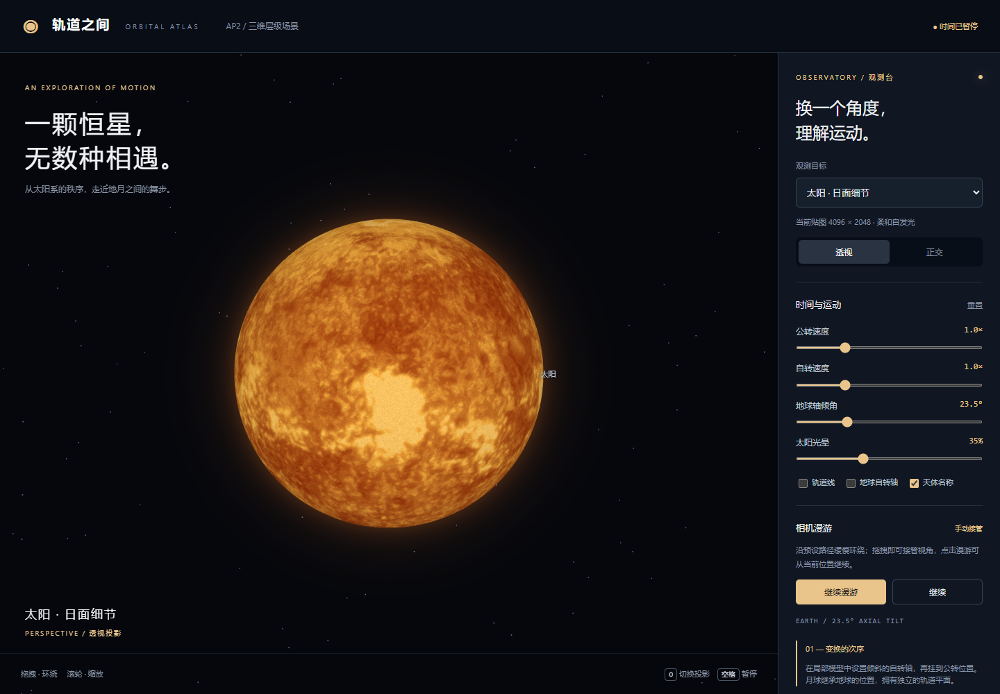
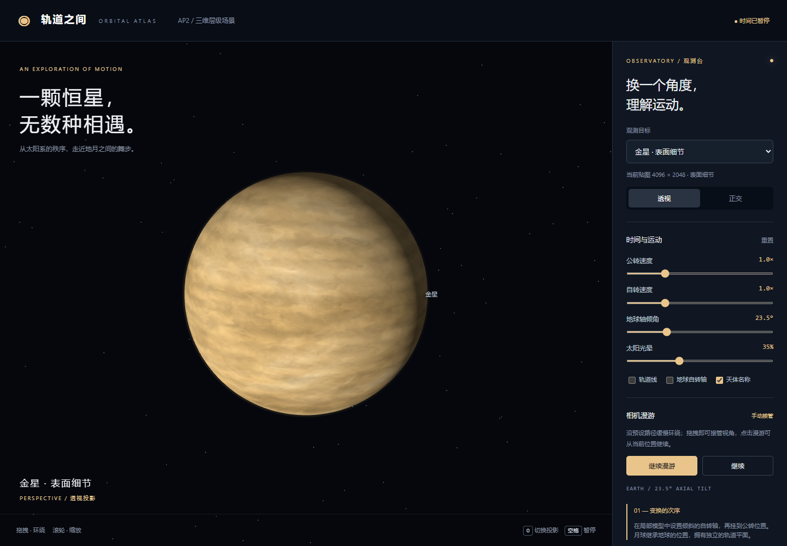
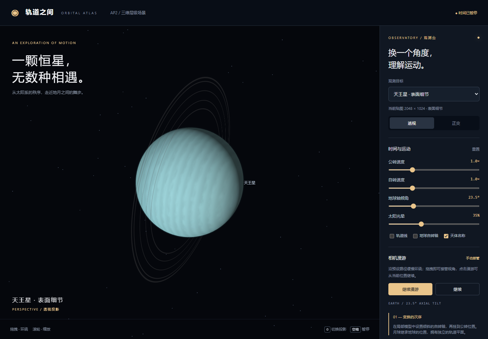
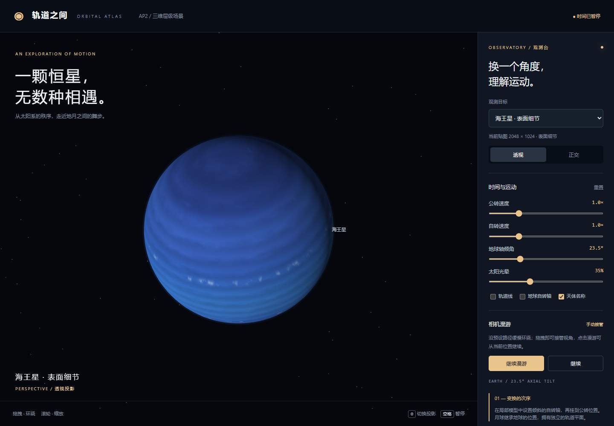
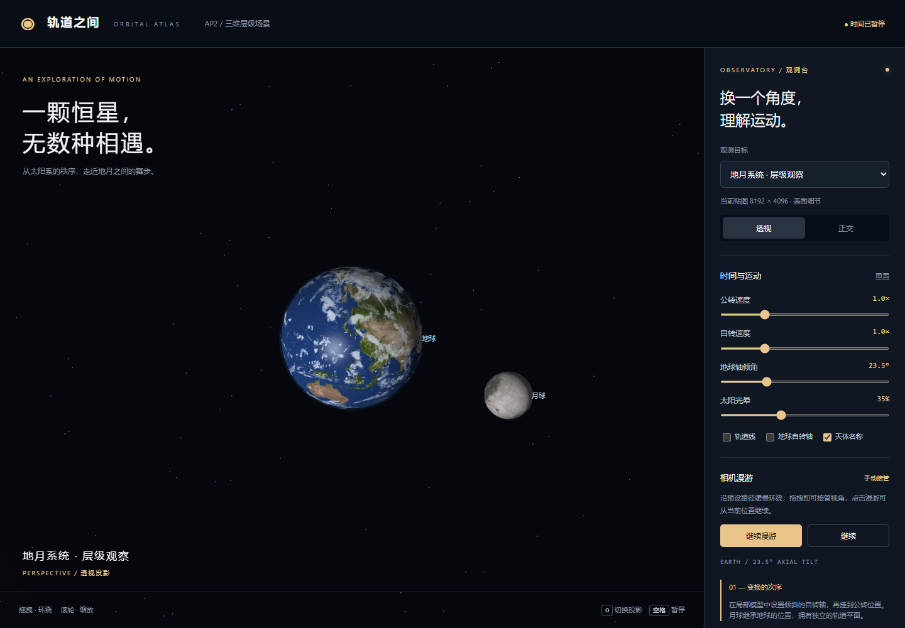
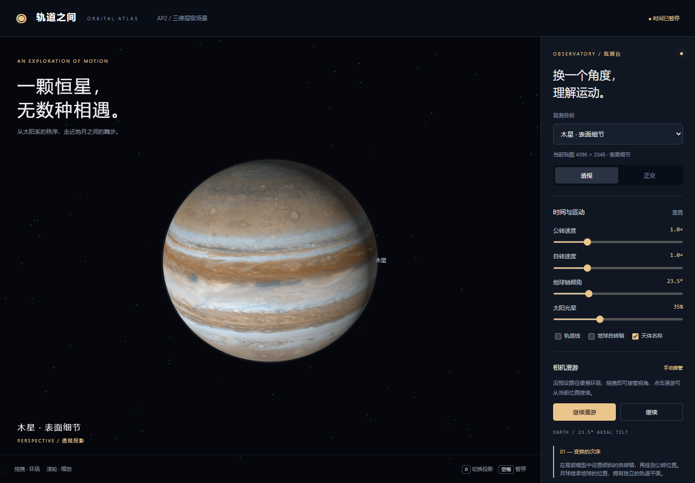
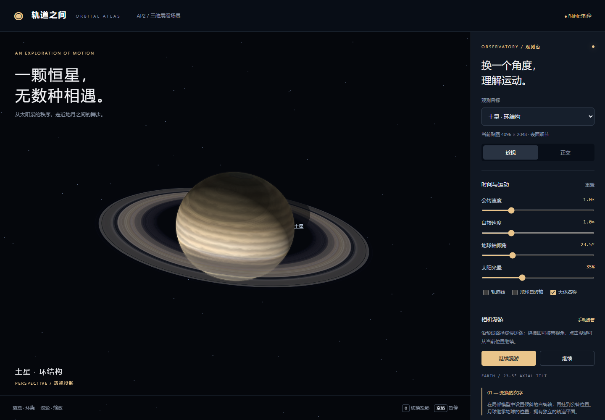


## 柔和发光与贴图细节

- 太阳是自发光恒星；行星在可见光下主要反射太阳光。本项目的行星大气边缘用于表现散射，不把行星改成自发光球。
- “太阳光晕”滑条默认 35%，可在 0～100% 间调节。它只调整日面外部的暖色光晕，不改变太阳自身的发光材质，也不把整个画面泛白。0% 关闭外部光晕，但太阳仍是自发光体。
- 近景尺寸在“观测目标”下方显示。地球、水星、火星可用原生 8192×4096；太阳、木星、土星、金星为 4096×2048；月球、天王星、海王星为 2048×1024。不通过把小图放大来宣称获得更高分辨率。
- 纹理着色增加轻量的局部对比增强；土星环开启三线性 mipmap 和可用的各向异性过滤，减轻远近变化时的锯齿、摩尔纹。贴图像素数量与真实地表细节不是同一件事，仍受素材质量限制。
- 新增 `tests/verify-glow.cjs`：验证可见光晕、默认亮度上限、滑条、正交视角、原生 8K 近景上传、快速切换和 GPU 资源释放。结果见 `evidence/glow-verification.json`。
- 交付物：在线运行地址、源码.zip、README、evidence 中的层级图/双投影截图/10 秒录屏。


## 一分钟课堂讲解

“这次用 MV.js 手动组合矩阵。太阳位于原点，地球先在自身模型里设置 23.5 度倾斜轴和自转，再挂到公转框架。月球挂在地球位置框架下，不继承地球自转，所以地球转快不会把月球甩着转。月球轨道用 5.1 度倾角矩阵乘公转旋转与平移构造。按 O 可以比较同一场景的透视和正交；空格暂停时间，拖动接管相机，再点漫游继续。扩展做了八颗行星、土星环和小行星带，尺寸和周期是教学压缩比例。”


## 小行星带细化（本地核对版）

850 颗岩块改为每颗 2,048 个三角形，总计 1,740,800 个三角形。连续位移产生不规则轮廓与凹坑，通过表面差分计算连续法线，减轻平面三角形的拼接感。采用三维程序岩石材质表现矿物色差与细颗粒，替代重复套用水星贴图；这是教学视觉增强，不是实测小行星地形。

大小分布以小岩块为主，少量较大岩块提供近景层次。共享顶点并按每 40 颗分批提交，所有批次都使用 16 位索引，不要求小行星网格具备 32 位索引扩展。选择“观测目标 → 小行星带 · 岩块”，滚轮拉近、拖拽查看。最新近景见下图。

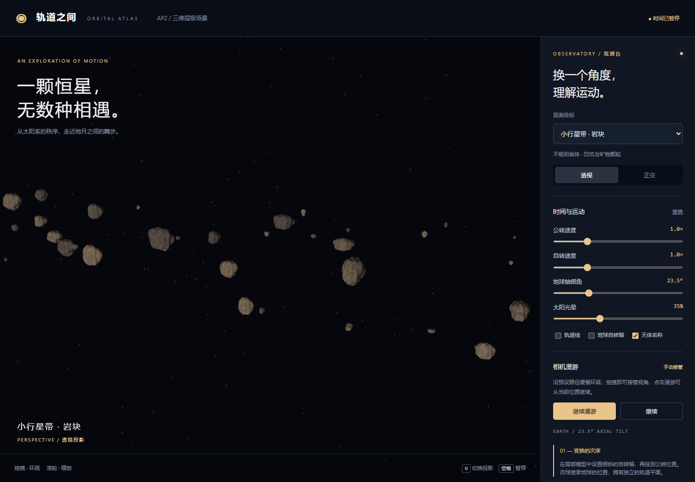
