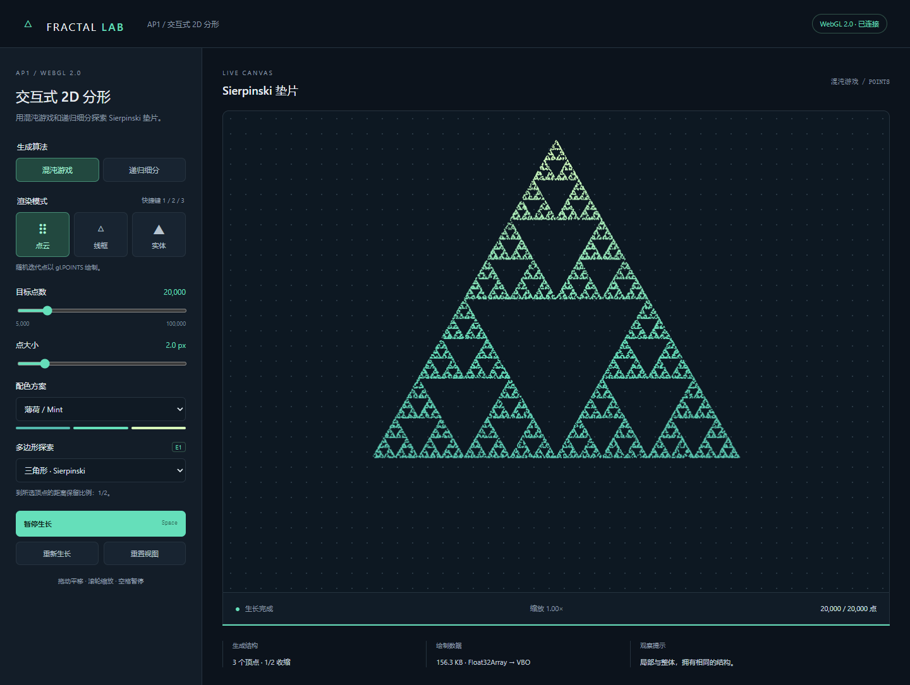
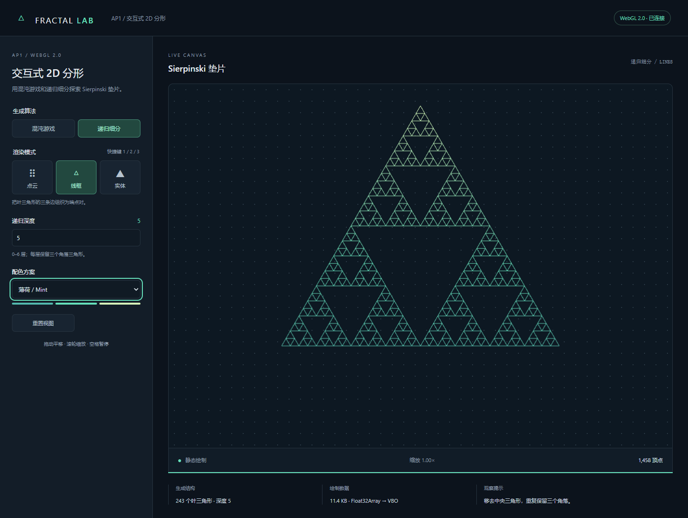
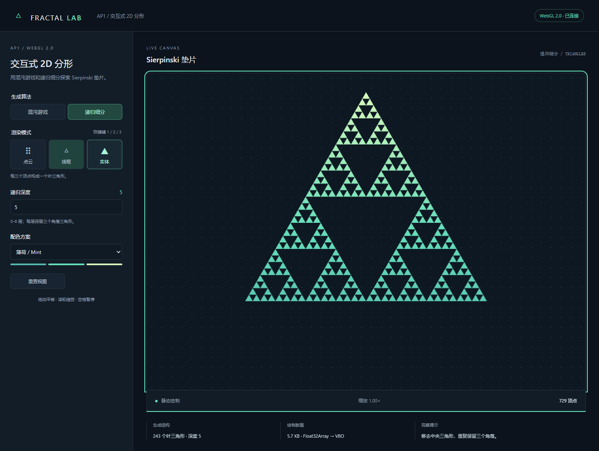

# Computer Graphics · AP1 交互式 2D 分形

原生 WebGL 2.0 + JavaScript，实现 Sierpinski 垫片的混沌游戏与递归细分。使用教材 `Common/initShaders.js`、`MV.js`、`webgl-utils.js`；着色器为 GLSL ES 3.00。无构建步骤、无 CDN、无运行时下载。

## 运行与提交

**本地查看：解压 ZIP 后，双击本目录的 `index.html`，用支持 WebGL 2.0 的 Edge / Chrome 打开。必须保留同目录下的 js、Common、styles.css。不要只复制 index.html。**

也可在本目录执行 `python -m http.server 8080`，然后访问 <http://localhost:8080>。安装 Node.js 的机器可使用 `npm start`，访问 <http://127.0.0.1:5174>。这些是可选的本地服务器，无须 `npm install` 或任何构建操作。

**GitHub Pages 公网 URL：<https://jinye2383-gif.github.io/Computer-Graphics/>**。站点采用公开访问，无需登录。本地地址和 `file://` 地址只用于预览，提交时使用此 HTTPS 地址。

源码仓库：<https://github.com/jinye2383-gif/Computer-Graphics>。解压后双击“项目.url”可在浏览器打开 GitHub Pages。

正式提交三项：

1. 公网 URL：上方 HTTPS 链接。
2. 源码 ZIP：包含本目录的 HTML、样式、JavaScript、Common 工具库、截图和 README。
3. 本 `README.md`：含运行方式、实现原理、交互说明、引用和三张截图。

网页全部使用相对资源地址，GitHub Pages 从 main 分支的根目录发布。根目录的 .nojekyll 告诉 GitHub 直接托管静态文件，不进行 Jekyll 内容转换。index.html、styles.css、js/、Common/ 即为完整网页；任意静态服务器仍可直接运行，无须构建。

## 操作说明

| 功能 | 操作 |
|---|---|
| 算法 | 点击混沌游戏 / 递归细分 |
| 三种图元 | 点云 / 线框 / 实体按钮，或按 1 / 2 / 3 |
| 混沌游戏点数 | 5,000–100,000，默认 20,000 |
| 递归深度 | 输入 0–6，按 Tab 或移开焦点生效；越界值自动限制 |
| 点大小 | 点云下调节 1–8 CSS 像素，实际范围受设备支持限制 |
| 配色 | 薄荷、落日、极光三套渐变 |
| 平移 | 画布内按住鼠标左键拖动 |
| 缩放 | 在画布上滚动滚轮，围绕鼠标位置缩放，范围 0.2–20 倍 |
| 暂停 / 继续 | 点击按钮，或画布有焦点时按空格 |
| 重新生长 | 复用当前点序列，从 0 开始播放并取消暂停 |
| 重置视图 | 恢复居中、1 倍缩放 |
| E1 | 混沌游戏下切换五边形 / 六边形 |

混沌游戏生成离散随机点，使用 POINTS；选择线框或实体时自动切换到递归算法，界面同步显示。递归三种模式共享同一组叶三角形；递归点云显示叶顶点，目标顶点数由深度决定，为 `3 × 3^depth`，可能包含重合顶点。

编辑输入框或选择框时不触发全局快捷键，以保留原生编辑行为。按钮上的空格保持原生点击行为。点云约 7 秒生长完成；少量递归顶点生长更快。切到后台不会累计生长进度。触屏支持单指平移。

## 两种生成算法

### 混沌游戏

用随机正权重的凸组合产生三角形内初始点 p。每一步等概率随机选择 A、B、C 中的一个顶点 v，并执行 `p = (p + v) / 2`。先舍弃 20 个过渡点，再保存至少 5,000 个坐标。三个收缩映射反复作用，使点分布逼近 Sierpinski 垫片。时间、空间复杂度均为 O(N)。

E1 推广到正五边形和正六边形：使用 `p = v + r * (p - v)`；r 是到选定顶点的剩余距离比例，三角形为 1/2，五边形为 `(3−√5)/2≈0.382`，六边形为 1/3。改变收缩比得到多边形自相似孔隙。

### 递归细分

`subdivide(triangle, depth)` 计算 AB、AC、BC 三个边中点，去掉中央三角形，递归处理 `[A,AB,AC]`、`[AB,B,BC]`、`[AC,BC,C]`。深度 0 保存原三角形。深度 d 有 `3^d` 个叶三角形，保留面积为初始面积的 `(3/4)^d`。时间和空间复杂度 O(3^d)。

深度 6 产生 729 个叶三角形；点云 / 实体提交 2,187 个顶点，线框提交 4,374 个顶点。有限深度几何与有限随机采样的显示细节不同，但都逼近同一三角形自相似集合。

## 顶点数据与渲染流程

1. `geometry.js` 生成 `Float32Array([x0,y0,x1,y1,...])`。
2. `renderer.js` 创建 VBO，通过 `gl.bufferData(gl.ARRAY_BUFFER, data, gl.STATIC_DRAW)` 上传。
3. `gl.vertexAttribPointer` 按每顶点 2 个 FLOAT 读取坐标。POINTS 与 TRIANGLES 都读取叶三角形的 A、B、C；LINES 读取 A、B、B、C、C、A。
4. `WebGLUtils.create3DContext` 创建 WebGL 2.0；`initShaders` 编译 HTML 内 GLSL ES 3.00 着色器；`MV.js` 的 vec2 / flatten 组织平移和长宽比 uniform。
5. 顶点着色器执行缩放、平移及长宽比校正，防止等边三角形被拉伸；片元着色器按原始高度配色。
6. `gl.drawArrays` 使用 POINTS / LINES / TRIANGLES。逐点生长只增加绘制 count，不每帧重传 VBO。拖动缩放只改 uniform，不重新生成几何。

应用只建立一个 `FractalLab` 命名空间，模块内部变量用函数作用域封装，状态留在 app.js 内。教材库保留原有全局函数接口。采用普通 defer 脚本按依赖顺序加载，兼容本地文件打开与静态服务器。

## 三种模式实际截图

截图由真实 Edge WebGL 2.0 页面运行产生。

### 点云：混沌游戏 20,000 点


### 线框：递归深度 5


### 实体：递归深度 5


## 源码结构

```text
index.html                页面入口、参数控件和着色器源码
styles.css                布局、配色、响应式样式
Common/                   教材工具库与来源说明
js/
  geometry.js             混沌游戏、递归细分、缓冲区组织
  renderer.js             上下文、着色器初始化、VBO、drawArrays
  interaction.js          鼠标、滚轮、键盘、触屏
  ui.js                   面板事件与可见状态
  app.js                  应用状态、算法切换、生长动画
screenshots/              真实运行截图
tests/                    算法测试与浏览器交互检查
scripts/serve.mjs         可选的本地服务器
verification-file.json    直接打开 index.html 的验证记录
verification-http.json    静态服务器打开的验证记录
README.md                 本说明
```

## 测试与演示

2026-10-10 已验证：13 项算法测试通过；直接打开 index.html 的 17 项浏览器交互检查通过；HTTP 加载的 5 项集成检查通过。两种打开方式均创建真实 WebGL 2.0 上下文，未发现 JavaScript 异常或 WebGL 绘制错误。HTTP 集成检查可运行 `node tests/http-check.cjs`。

算法测试：`node --test tests/geometry.test.mjs`，覆盖 0–6 层数量、面积、三种缓冲区组织、10 万点的坐标范围和异常输入。

浏览器检查需要测试用 Playwright 和 Edge；它们不属于网页运行依赖。设置 NODE_PATH 指向已有 Playwright 的 node_modules 后，运行 `node tests/browser-check.cjs`，默认检查本地 5174 端口。TEST_URL 可切换到 index.html 的 file:// URL；TEST_REPORT 可指定验证记录路径。具体执行结果见两份 verification JSON。

现场演示建议：默认点云 → 空格暂停 / 继续 → 点数 / 大小 / 配色 → 按 2 → 递归深度 6 → 按 3 → 按 1 → 拖动 / 滚轮 → 重置 → 五边形 / 六边形。

抽问要点：

- LINES 为什么每个三角形需要 6 个顶点？每两顶点是一条边，三条边需三对端点。
- 叶数为什么为 3^d？每个父三角形只保留 3 个子三角形。
- 如何暂停？不增加已显示点数，保留当前 VBO。
- 为什么缩放不改变点大小？位置变换和 gl_PointSize 是不同 uniform。
- 为什么三种递归模式共享几何？缓存叶三角形，只重组 VBO 顶点序列。

## 引用与 AI 辅助说明

教材工具库来自 Edward Angel 的配套目录：<https://www.cs.unm.edu/~angel/WebGL/CODE/Common/>，获取日期 2026-10-10。initShaders.js、MV.js、README.txt 原样使用；webgl-utils.js 仅把上下文候选列表改为 `["webgl2"]` 并加入注释。原文件的版权和说明保留，详见 `Common/SOURCES.md`。

应用几何、渲染、交互、UI、测试及文档由本次 Codex AI 辅助编写和整理，部分逻辑沿用本会话前一版实现，没有复制其他学生项目。不能将此材料视为“全部由学生独立撰写”的证明；学生应依课程的 AI 辅助规定处理，并自行理解、修改和演示。

本项目实现 AP1 必做项及 E1；E2、E3 未实现。最终成绩由教师评定。课程说明书的总览与分项标题存在不同的周次安排，截止日期以教师或课程平台确认为准。
